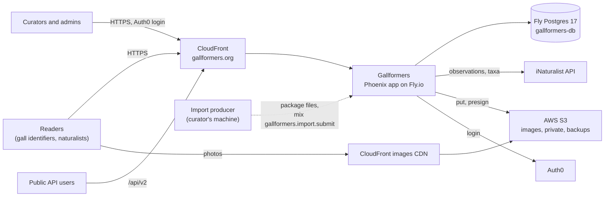
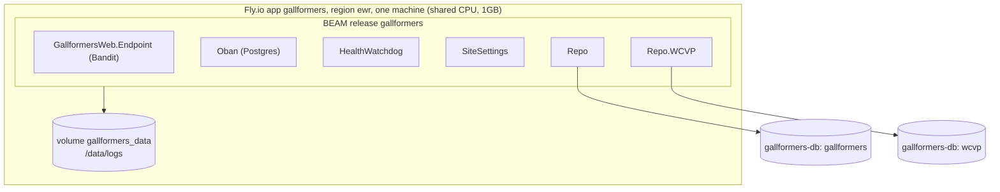
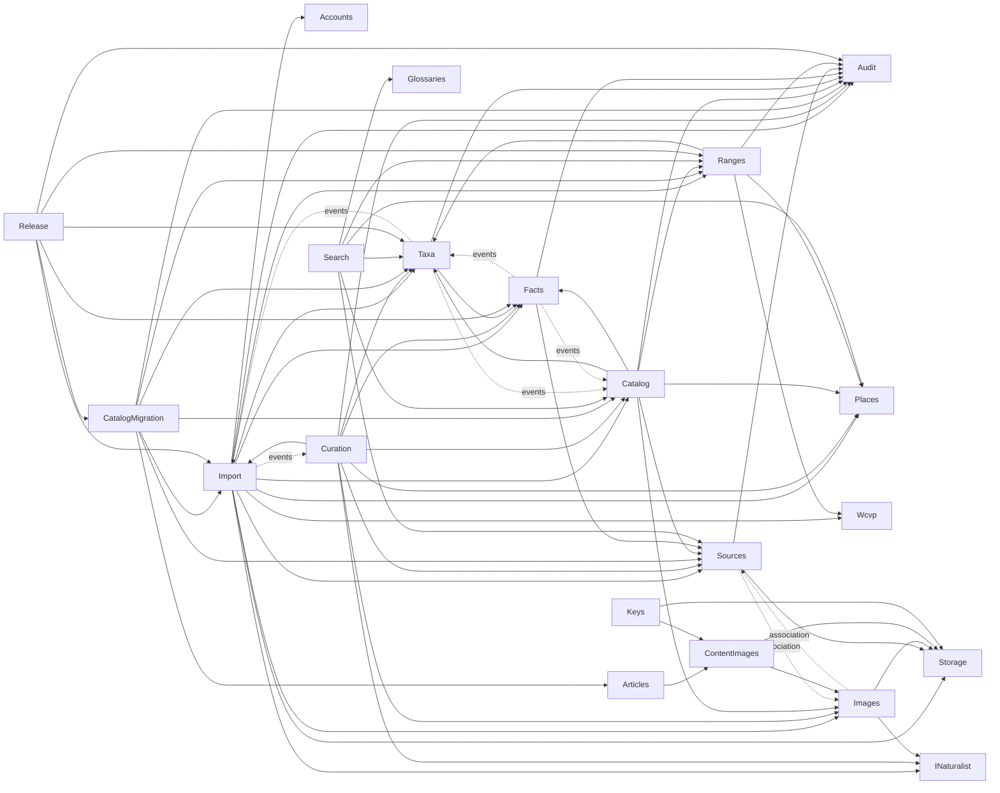

# Architecture

The current state of Gallformers' architecture and design: what the system is made of and how its parts connect, as built on the `taxogall` branch (Jeff, 2026-11-26). It describes only what exists. Planned work lives in the plans ([Taxogall](../taxogall/README.md) and the others in `docs/`) and moves into this doc in the same commit as the code that lands it.

**Production runs the old back-end until cutover.** `main` serves the old species-centric model (one `species` table behind galls and hosts, with `gall_range`, `gallhost` and the trait junction tables). On `taxogall` the code runs on the new back-end described here; the old tables are still in the database because the catalog migration reads them, and they go after release.

The look is governed by the design system in [docs/design-system/](../design-system/README.md) (DESIGN.md points there); this doc covers its structure, not its look. Coding style is in [CODING_STANDARDS.md](../../CODING_STANDARDS.md) and Credo, not here.

## How this doc is kept

- **[README.md](README.md)** (this file): the current state. It changes in the same commit as the code that changes the architecture.
- **[rules.md](rules.md)**: the architectural rules Jeff has stated, each with its check (or "manual") and its baseline of known violations.
- **[decisions.md](decisions.md)**: Jeff's decisions that shape the architecture, newest first. A new decision is added there, and this file and rules.md are updated to match, in the same commit.
- **[reviews.md](reviews.md)**: one entry per periodic review of the code against this doc. Each finding becomes a fix, an accepted exception with a reason, a new rule with a check, or stays open for Jeff.

A rule's check starts at its baseline: today's count of violations is recorded, the check fails when the count grows, and the baseline is lowered as violations are fixed (the pattern the design-system conformance test and the duplicate-code test already use). A rule with no check is reviewed by hand until it has one.

## System context

- **Readers** use the public site; every public page is readable without login.
- **Curators and admins** log in with Auth0 and edit on the public pages (Edit mode and the change tray) and in `/admin`. There is no sign-up; roles are set in Auth0.
- **The public JSON API** (`/api/v2`) is read-only, unauthenticated and rate limited, documented by an OpenAPI spec at `/api/docs`.
- **The import producer** (`services/import-producer/`, Python) turns a Source's document into an import package, running headless Claude Code on the curator's own subscription. It runs only locally; a package reaches the app as files through `mix gallformers.import.submit` (dev only). The app itself makes no LLM calls.
- **WCVP** (Kew's plant checklist) is a separate database on the same Postgres cluster, restored from a dump; the app reads it, never the Kew site.

## Runtime

- **One machine, one database cluster.** Production Postgres is self-managed Fly Postgres (`gallformers-db`, postgres-flex 17), reached over Fly's private IPv6 network. The app's volume holds only log files. The in-memory rate limiter and the SiteSettings cache assume one machine; `fly.toml` keeps one running and sets no maximum. DNSCluster is started with no query and does nothing.
- **Boot** (`docker-entrypoint.sh`): run `Gallformers.Release.migrate/0` (three tries), then the server. Migrations run here, not as a Fly release command. The catalog migration (`Release.migrate_catalog/0`) never runs at boot.
- **Supervision tree** (`lib/gallformers/application.ex`, one-for-one, in order): Telemetry, Repo, Ecto.Migrator (skipped unless `RUN_MIGRATIONS=true`, which nothing sets), Oban, Repo.WCVP, DNSCluster, PubSub, HealthWatchdog (`SELECT 1` every 30s; stops the node after five failures so Fly restarts it), SiteSettings (settings cached in `:persistent_term`, refreshed over PubSub), Endpoint.
- **Background work.** Oban on the main Repo, queues `default` (10, unused), `maintenance` (5), `import` (1), `catalog` (5); plugins Pruner (7 days), Reindexer, Lifeline (1 hour), Cron. Workers: `Analytics.RollupWorker` (daily at 07:00 UTC), `Import.Worker` (moves one package a step on, unique per package), `Catalog.ReadModels.GallIndexWorker` (refreshes one Gall's ID-tool row, unique per Gall, enqueued inside the change's transaction). Dashboard at `/admin/jobs`. Outside Oban, `Gallformers.Async.run/1` is an unsupervised `Task.start` (synchronous in tests) used for image variants, page-view writes, the iNat photo import and key PDFs.
- **Events inside a transaction.** `Taxa.Events`, `Facts.Events` and `Import.Events` call their listeners synchronously inside the writer's transaction, so a listener can refuse the change. The listeners are wired in `config/config.exs`: Catalog's `TaxonListener`, Import's `TaxonMerges`, `GallRenames` and `SplitQuestions` on taxon changes; Catalog's `FactListener` and `Taxa.Sync` on Fact changes; Curation's `PackageListener` on import changes.
- **PubSub.** `audit:changes` (the Changes page and dashboard), `catalog:records` (record deletions, to open Gall and Host pages), `curation:user:<id>` and `curation:<type>:<id>` (the change tray), `glossary`, `site_settings`. `articles` is broadcast but nothing subscribes.

## Code structure

A Phoenix monolith: business logic in `lib/gallformers/` as contexts, the web layer in `lib/gallformers_web/`, mix tasks in `lib/mix/tasks/`, development-only code (Credo checks, style guide, mockups) in `dev/`. Every context declares its dependencies and exports with [Boundary](https://hexdocs.pm/boundary), so `mix compile --warnings-as-errors` fails on an undeclared call ([rules.md](rules.md), S2).

### Contexts

The new back-end ([taxogall](../taxogall/README.md)): two systems, taxonomy (`Taxa`) and galls (`Catalog`), sharing Sources and Facts, audit and import.

| Context | Responsibility | Owns (tables) |
|---|---|---|
| `Gallformers.Taxa` | Taxa at every rank, their names, placement tree and ancestry, taxonomic acts as Facts, name resolution. Knows nothing about Galls. | `taxa`, `taxon_names`, `taxon_common_names`, `legacy_taxon_ids`, `taxon_ancestry`, `taxon_notes`, `taxon_redirects`, `taxon_inaturalist`, `placement_facts`, `name_facts`, `synonymy_facts`, `split_facts`, `split_fact_daughters`, `common_name_facts` |
| `Gallformers.Catalog` | Galls, the gall Fact kinds, trait vocabularies, generation groups, relationship types, and the read models every public page reads (`ReadModels.*`: Gall page, browse, search, API, ID tool, potential range) | `galls`, `gall_redirects`, `non_gall_redirects`, `fact_notes`, `pending_trait_terms`, `legacy_citations`, `trait_values`, `trait_term_mappings`, `generation_groups`, `generation_values`, `generation_group_taxa`, `relationship_facts`, `qualifier_facts`, `trait_facts`, `range_facts`, `occurrence_facts`, `alias_facts`, `description_facts`, `gall_index` |
| `Gallformers.Facts` | Facts, their attributions to Sources, standings and contests (newer work wins) | `facts`, `attributions`, `attribution_evidence`, `attribution_names`, `attribution_observations` |
| `Gallformers.Sources` | Sources, their stored documents (Docling output) and locating quotes in them | `source`, `source_documents`, `document_items` |
| `Gallformers.Audit` | The audit layer: opens each audited transaction with its actor and operation (Carbonite), and the change log | `carbonite_default.transactions`, `carbonite_default.changes` |
| `Gallformers.Import` (~70 modules) | Takes an import package in (the contract in `priv/import/`): validate, resolve, the review queue, apply, the replay log, undo | `import_packages`, `import_batches`, `batch_statements`, `batch_unmapped`, `queue_items`, `queue_item_notes`, `replay_log`, `source_corrections`, `package_statement_edits`, `trait_term_candidates` |
| `Gallformers.Curation` | A curator's change set (the tray): edits held on the pages, applied through the import | `change_sets`, `change_set_items` |
| `Gallformers.CatalogMigration` | The bridge: fills the new tables from the old ones (`mix gallformers.catalog.migrate`, `Release.migrate_catalog/0`) | none; reads the old tables |

Kept from before, re-keyed to the new model where they point at taxa or Galls:

| Context | Responsibility | Owns (tables) |
|---|---|---|
| `Gallformers.Ranges` (+ `Wcvp`, `WcvpAuthorship`) | Host ranges of plant taxa, WCVP links, WCVP authorship | `host_range`, `taxon_wcvp` |
| `Gallformers.Places` | Places and their hierarchy | `place`, `place_hierarchy` |
| `Gallformers.Images` | Images of Galls and taxa; variants | `image` |
| `Gallformers.Accounts` | Users, synced from Auth0 at login | `users` |
| `Gallformers.Articles`, `Keys`, `Glossaries`, `ContentImages` | Articles, dichotomous keys (PDFs through Typst), the glossary, and images owned by articles and keys | `articles`, `keys`, `glossary`, `content_images` |
| `Gallformers.Analytics` | Page views and their daily rollups | `page_views`; `daily_stats`, `daily_page_stats`, `daily_referrer_stats`, `daily_device_stats`, `daily_browser_stats` (no schemas) |
| `Gallformers.SiteSettings` | Read-only mode and the site banner | `site_settings` |
| `Gallformers.Search` | Global search across the other contexts | none |
| `Gallformers.Wcvp` | WCVP reference data, read through `Repo.WCVP` | `wcvp_names`, `wcvp_distributions` (in the `wcvp` database) |
| `Gallformers.INaturalist` | iNaturalist API client | none |
| `Gallformers.Storage` (+ `S3`, `Images`, `PDFKeys`, `Private`) | S3 behind one wrapper: public images, key PDFs, the private bucket (adapters for S3, local disk and a test stub) | none |
| `Gallformers.Release` | Release tasks: migrate, migrate the catalog, replay export and import | none |

The old model: `Gallformers.Galls` has no boundary of its own (it falls in the root boundary): `Galls.Identification` is the old ID filter, used only by `mix gallformers.catalog.id_parity`, and `Galls.Summary` is a pure text helper the Gall page and ID tool still call. The old tables (`species`, `taxonomy`, `alias`, `gallhost`, `gall_traits`, `host_traits`, `species_source`, `gall_range`, the `gall_*` trait junctions and their lookup tables, `abundance`) have no Ecto schemas; they are read by the catalog migration, and a few places still read them ([rules.md](rules.md), S10).

Shared utilities, usable by any context: `Repo` (with `Repo.WCVP` and `Repo.DevShell`, which refuses to start in dev outside the Nix shell), `ChangesetHelpers`, `SchemaFields`, `TextMatch`, `TaxonName`, `Async`, `Jobs`, `Licenses`, `Version`, `Markdown`.

### Dependencies as they are

From `mix xref graph`, folded into contexts (2026-11-26, at bd3c5061). Utilities are left out. Solid lines are calls Boundary checks; dotted lines are the in-transaction event listeners wired in config, which xref and Boundary don't see. `GallformersWeb` depends on most contexts and is left out; the only edges from business logic into the web layer are the Application starting the endpoint and telemetry.

Boundary reports no violations and no cycles. What it doesn't see: associations and type atoms (Images and Sources point at each other; ContentImages at Articles, Keys and Sources), raw SQL and string table names (Audit's change log joins about fifteen other contexts' tables), the root-boundary `Galls.*`, and the config-wired listeners, which make runtime cycles between Taxa, Facts, Catalog, Import and Curation. The web layer's 16 `dirty_xrefs` (`lib/gallformers_web.ex`) are its declared exceptions. Where contexts reach into each other's tables is listed in [rules.md](rules.md), S1.

## Data

- **PostgreSQL 17** (Nix in dev, `postgres:17` in CI, postgres-flex in production). No PostGIS. Schemas `public` and `carbonite_default`.
- **Schema is defined only by migrations** in `priv/repo/migrations`, from a baseline generated from the Ecto schemas at the move to Postgres (`20260312200000_baseline.exs`); there is no `structure.sql`. Production applies pending migrations at boot. One-off data fixes have been kept in `priv/repo/manual_patches/`.
- **One ID sequence** (`entity_id_seq`) for Galls and all taxa, continuing the old species IDs, so a Gall or plant keeps its URL and image paths. Inducers and higher taxa got new IDs in the catalog migration, which crosswalks the old higher-taxon IDs so their URLs still resolve (`Gallformers.CatalogMigration`).
- **A Fact's identity.** A Fact (`Facts.Fact`) has a kind, its typed details in a table Catalog or Taxa owns, and two keys that never change once it exists: its `slot` groups the Facts that compete for one value (a Gall's detachable, a taxon's placement; multi-valued kinds have none), and its `contest` groups Facts that claim one thing for different holders (a name as one taxon's accepted name or another's synonym). `Facts.Standing` settles both.
- **The taxon tree** (`taxa`' placement and `taxon_ancestry`) is what every page reads, rewritten from the accepted taxonomic Facts in the same transaction by `Taxa.Sync`, which refuses an acceptance that would break the tree; `Taxa.Sync.check/0` (`mix gallformers.taxa.check_sync`) rebuilds the expected tree from the Facts and lists the rows that differ, and a test asserts it is clean.
- **Audit.** Carbonite triggers record every insert, update and delete on a tracked table, with the replaced values, against an audit transaction. `Audit.transaction/3` and `Audit.run_multi/3` open that transaction with the actor (`Audit.Actor`: a user, or a named system process) and the operation; a CHECK constraint requires both, and Carbonite refuses a write to a tracked table with no transaction, so a write that names no actor fails in the database. Two actors in one transaction raise. Tables are tracked one by one in migrations (`Audit.Migration.track_table/2`): 46 today, the Taxa, Catalog, Facts and Import tables plus `source_documents` and `taxon_wcvp`. Not tracked: `source`, `document_items`, `host_range`, `image`, `place`, `users`, `change_sets`, the content tables (articles, keys, glossary), `gall_index` and `taxon_ancestry` (rebuilt from tracked data), and the old tables.
- **Concurrency.** Fact writes, vocabulary writes and taxonomic acts serialise on one transaction-level advisory lock (key 9449); the taxon tree rebuild has its own.
- **Read models.** Public pages read `Catalog.ReadModels.*` and `Taxa.ReadModels.*`, computed on read from current Facts, except the ID tool's `gall_index` (one row per Gall), refreshed by Oban after each change commits, and `taxon_ancestry`, rebuilt by Taxa.

### Ranges and places

- **Places**: `place` and `place_hierarchy`: continents, countries and their subdivisions (ISO 3166-2 codes), walked with recursive CTEs. Leaf places (subdivisions, or countries without them) are what ranges are made of. A place's `code` joins it to the map's vector tiles (`boundaries.pmtiles`, built by `services/boundaries/` from Natural Earth and served from S3 through CloudFront).
- **Host ranges**: `host_range` rows on a plant taxon (`taxon_id`), each a place with its precision (`exact`, or `country` for the whole country, expanded to its leaves for display) and distribution (`native` or `introduced`). Written only through `Ranges.update_taxon_places/3`. They are rows, not Facts, and are not audited. The old key `species_id` is still filled beside `taxon_id`.
- **WCVP sync**: WCVP records plant distribution in TDWG level-3 botanical regions; `priv/repo/data/tdwg_to_places.json` maps the 368 regions to ISO places, many-to-many (generated by `services/boundaries/generate_tdwg_mapping.py`). Because two regions can map to one place, a plant can come out native and introduced in the same place; native wins. The Host range review (`/admin/host-range`) syncs many plants at once; the range editor on a taxon shows a diff against WCVP (add, remove, reclassify) for the curator to pick from (`Ranges.Wcvp.compute_powo_diff/3`). `taxon_wcvp.range_confirmed` marks a Host range a curator has confirmed.
- **A Gall's potential range** (`Catalog.ReadModels.PotentialRange`) is computed, never stored: the union of its current Hosts' ranges (a genus Host stands for every taxon under it), then narrowed by its current range Facts (`range_facts`: `only` this place, or `exclude` this place). Nothing widens it. A Gall with no range data is `:everywhere`, as on the old site. This is not yet the [domain doc](../domain/domain-model.md#ranges)'s potential range (Hosts' native range only, introduced places only with evidence; the [backlog](../backlog.md)'s ranges entry).
- **Recorded occurrences** (`occurrence_facts`) are places where a Source says the Gall has been found, separate from the range. Browse by place counts a Gall where its Hosts are native or where it has been recorded (`PotentialRange.known_for_galls/1`).

## Web layer

- **Endpoint**: static files; LiveView socket (websocket and long-poll); request ID; the client IP from `fly-client-ip`; telemetry; forwarded-header rewrite for CloudFront; body parsers; signed and encrypted session cookie (SameSite Lax, secure in prod); the router. HTTPS is forced by Fly and CloudFront, not the app.
- **Pipelines**: `:browser` (session, CSRF, secure headers, CSP, browser-support banner, current user, analytics), `:api` (JSON, open CORS, an hour's cache with ETags, OpenAPI spec), `:admin` / `:superadmin` / `:operator` (role plugs; read-only mode on the first two). `/health`, `/sitemap.xml` and `/robots.txt` sit outside every pipeline.
- **Authentication**: Auth0 through Ueberauth; there are no passwords in the app. At login the Auth0 user and its roles (`admin`, `superadmin`, `operator`, from a custom claim) go into the session, and the local `users` row is synced. Roles are read from the session until the next login. In dev, `dev_auth_bypass` signs every request in as an all-roles admin.
- **Authorization**: live sessions with on_mount guards: `:public` (fetches the user and, for an admin with a local user row, the curator as an `Audit.Actor`), `:admin` (`require_admin_actor`, for the new back-end's admin screens), `:superadmin`, `:operator`. The content admins (glossary, articles, keys, profile) and the Oban and LiveDashboard mounts are gated by the role plugs only. Public pages enter Edit mode only with a curator; their editing events and the tray act only when the curator or edit state set at mount allows. Writes through the new back-end carry the actor.
- **Read-only mode** (`SiteSettings`, set at `/admin/ops`): `EnforceReadOnly` answers 503 on the admin pipelines' HTTP requests, except `/admin/ops`. Under CloudFront, a maintenance page can replace the whole site (`tofu apply -var maintenance_mode_enabled=true`), and an outage page is served when the origin fails.
- **CSP** is sent report-only, with no report endpoint: `default-src 'none'`, `script-src 'self'` plus a per-request nonce, `style-src 'self' 'unsafe-inline'`, images from the site, the images CDN and Auth0/Gravatar, connections to S3 for uploads, `frame-ancestors 'none'`. The enforced headers are Phoenix's defaults.
- **Pages**: about 25 public LiveViews (home, Gall, Host, species, rank pages, browse galls, hosts and places, ID tool, search, keys, glossary, sources, analytics, user profiles) and a few controllers (about, articles, privacy, filter guide); the admin's review screens (all on `Import`), sources, taxonomy and ranges, changes, observations, vocabulary, users and ops; `PaletteLive` (the command palette) and `TrayLive` (the change tray) are rendered on every page from the root layout. Old URLs redirect (`LegacyEntityRedirect`, `AdminRedirectController`). Dev-only routes (`/dev/design-system`, `/dev/mockups/*`, `/dev/mailbox`) exist only with `dev_routes`.
- **Public API** (`/api/v2`, 22 GET routes): Galls, Hosts, taxonomy, Sources, glossary, places, search, stats; OpenApiSpex specs on the controllers (`ApiSpec` 2.1.0), JSON from the read models; 100 requests a minute per IP (Hammer, in memory). CI fails a PR that changes an API controller without bumping `API_VERSION`.
- **Uploads** go from the browser straight to the public images bucket through presigned PUT URLs; the app then makes the variants.

## Front end and design system

- **Rendering**: server-rendered LiveView. One JS bundle (`assets/js/app.js`, esbuild) with LiveView, topbar, the theme and search shortcut, and 19 hooks in `assets/js/hooks/`, each with a Vitest test (`npm test`). npm dependencies are only MapLibre GL and PMTiles, for the range maps; MapLibre's worker is a second bundle. No external scripts or fonts on site pages: fonts are self-hosted. Swagger UI on `/api/docs` loads from cdnjs.
- **CSS**: Tailwind v4 (pinned binary). `assets/css/system/` holds the design system: `tokens.css` (light and dark, two densities), `fonts.css`, `base.css`, `components.css`. Icons are vendored (Phosphor, plus Gallformers' own).
- **Component library** (`lib/gallformers_web/components/`): Core, Action, Data, DataDisplay, Domain, Facts, Feedback, Form, Key, Layouts, Page, RankPage, Review, Curation, SEO and UI component modules. The catalog of what exists, with each component's status, is [components.md](../design-system/components.md); the living style guide is `/dev/design-system`.
- **Conformance**: `GallformersWeb.DesignSystem.Conformance` (in `test/support/`, a ratchet on heartwood_guardrails' `Patterns`) scans `lib/gallformers_web` templates and the CSS for off-system styling (palette colours, the legacy palette, type scale, radius, shadow, arbitrary values, dark variants, inline styles, hex colours, letter case), and a test holds each file's count at its baseline (`test/support/design_system_baseline.json`). The rules and how to change the system are in the [design-system README](../design-system/README.md).

## Delivery

- **Toolchain**: one Nix flake for dev and CI (Elixir 1.19, OTP 28, Postgres 17, Node 22, Python 3.13 with uv, Typst, Tailwind, libvips, Tesseract and Ghostscript for the producer), loaded by direnv. The project's own Postgres runs on `127.0.0.1:54317` (`scripts/dev-db`). The Dockerfiles must match the flake, which heartwood_guardrails' `check-toolchain` checks in `make done-checks` and CI. OpenTofu, the AWS and Fly CLIs come from outside the flake.
- **Checks**: `mix precommit` (format check, compile with warnings as errors and Boundary, Credo strict, JS tests, `mix test` with the guardrail and conformance tests); `make done-checks` adds a test database rebuild, `check-toolchain`, Dialyzer and `mix heartwood.status`. The guardrails come from **heartwood_guardrails** (`~/dev/heartwood`, shared with Oak Compendium; a dev and test dependency pinned by tag, `@heartwood_tag` in `mix.exs`), configured in `dev/guardrails/config.sh`: the commit gate (`dev/githooks/pre-commit`) blocks a commit without a passing fresh-context review of the staged tree (heartwood's packet plus `dev/guardrails/checklist.md`), except one touching only the prose paths there; the pre-push hook blocks force pushes and pushes to main; the duplicate-code, retirements and conformance ratchets; and the architecture review's packet (`mix heartwood.architecture`, with `dev/guardrails/architecture.md`). CI runs on pushes to `main` and on every PR into `main` or `taxogall`, skipping the code jobs on a PR that changes only prose (heartwood's `actions/changes`; they run if it fails): check-toolchain, the test database, `mix precommit`, the asset build, Dialyzer, and the API version check; a Security Audit workflow (`hex.audit`, `deps.audit`, Sobelow at high confidence) runs on PRs, `main` and weekly, not yet a required check. Every workflow's token is read-only. Pushes to `taxogall` get no CI run; its PRs do. Until cutover, Dependabot's version updates (grouped, one PR per ecosystem) target `taxogall`, and `main` takes only hotfixes. The full list of checks, and what each enforces, is in [rules.md](rules.md).
- **Release**: PRs to `main`; Jeff merges on GitHub. A green CI run on `main` triggers `flyctl deploy --remote-only`, then `mix smoke_test` against `gallformers.fly.dev`. A Discord message announces each GitHub release.
- **Preview**: a second Fly app (`gallformers-preview`, iad, `fly.preview.toml`, `Dockerfile.preview`) deployed by hand with `make preview`. Its images go under a `preview/` prefix in the images bucket; it shares the private bucket with production.
- **Infrastructure**: AWS is described in OpenTofu (`infra/`, state in S3 `gallformers-terraform-state`): buckets `gallformers-images-us-east-1` (public images, map tiles, maintenance and outage pages), `gallformers-private` (Source documents and import material; blocked from public access), `gallformers-backups` (public snapshot and the WCVP dump) and `gallformers-full-backups` (private); the images CDN; the site's CloudFront distribution in front of Fly, with its certificate, caching of `/assets/*`, map tiles from S3, and the maintenance and outage pages; IAM users for the app's uploads and for backups; Route53 for `gallformers.org` and `.com`; and the downdetector Lambda. Outside tofu: the Fly apps, volumes, Postgres and secrets; GitHub secrets; access keys; Auth0; the registrar (Porkbun). Details in [infra/README.md](../../infra/README.md).
- **Environments**: dev on port 4000 with private storage on local disk and the auth bypass; tests on a database per checkout (`config/test_db_names.exs`, rebuilt by `make test-db` from `priv/repo/test_seeds.sql` through the catalog migration), with S3 off, iNat through `Req.Test`, WCVP stubbed and Oban inline; preview and production as above.

## Observability and data safety

- **Logs**: JSON (LoggerJSON) to stdout, which Fly collects, and in production a rotating file on the volume (`/data/logs`, 50MB × 20). Request logs come from LoggerJSON's plug; Phoenix's own request logging is off.
- **Metrics**: Telemetry metrics are defined and shown in LiveDashboard (`/admin/dashboard`, superadmin); no reporter sends them anywhere. Fly's own metrics are on fly-metrics.net.
- **Errors**: no error tracking service.
- **Health and alerting**: `GET /health` runs `SELECT 1` (Fly's check, every 30s); HealthWatchdog restarts the machine when the database stops answering; the downdetector Lambda requests the home page every 5 minutes and emails on failure (CloudWatch and SNS); a public status page (Upptime) lives in another repo.
- **Backups**: a GitHub workflow dumps the production database daily to `gallformers-full-backups`, then builds the public snapshot from it (dropping the audit schema and the private tables in `priv/snapshot/tables.txt`, failing closed on any table it doesn't know) and publishes it to `gallformers-backups`. The images bucket is versioned.
