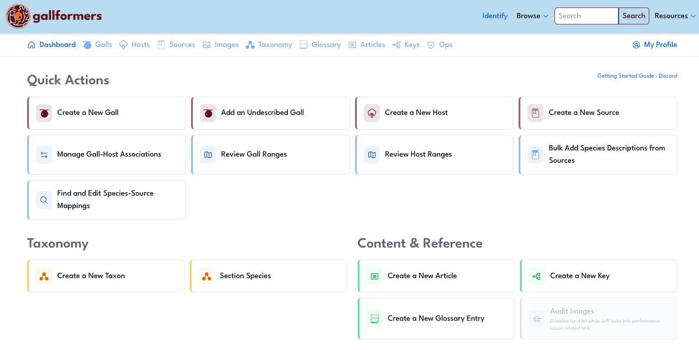

<!-- _class: cover -->

# Gallformers Reimagined

Jeff Clark and Adam Kranz November 17, 2026

---

<!-- _class: prose roomy purpose -->

# Gallformers' Purpose

Gallformers' primary objective is to document the world of plant gall communities.

Gall Community

the inducer the host the inquilines the parasitoids the herbivores etc.

---

<!-- _class: bignum -->

Gallformers has 931 <strong class="term">Sources</strong>, of which only 25% are complete.

Of these, 5 are responsible for 51% of the species.

641 galls are backed only by Gallformers data, of which 603 are undescribed.

And 53 are not even linked to a single species!

---

<!-- _class: statement questions -->

# How much have we drifted from the current state of knowledge?

# How can we know?

# How would we fix it all?

# How do we maintain it over time?

---

<!-- _class: prose roomy -->

# Impactful Decisions

Gallformers' primary objective is to document the world of plant gall communities. Therefore we will no longer work to catalog non-galls or gall lookalikes.*

Every <strong class="term">Fact</strong> in the system about a gall community is traceable to its <strong class="term">Source</strong>.

* We fully acknowledge that the exact definition of a gall is very imprecise and that is OK.

---

<!-- _class: model -->

# An Improved Data Model

Was

Gall

&#8597;

Species

Today a Gall is a Species.

New

<svg viewBox="0 0 640 360" xmlns="http://www.w3.org/2000/svg" font-family="League Spartan, sans-serif" role="img" aria-label="A Gall at the centre with typed relationships: an inducer Species shared with its alternate-generation Gall, a host Species and a parasitoid Species"><g stroke="#585563" stroke-width="3"><line x1="200" y1="200" x2="420" y2="52"/><line x1="560" y1="200" x2="420" y2="52"/><line x1="200" y1="200" x2="560" y2="200"/><line x1="200" y1="200" x2="80" y2="70"/><line x1="200" y1="200" x2="80" y2="310"/></g><g font-size="17" font-weight="700" fill="#bc6428" text-anchor="middle"><rect x="266" y="112" width="88" height="28" rx="14" fill="white"/><text x="310" y="132">inducer</text><rect x="446" y="112" width="88" height="28" rx="14" fill="white"/><text x="490" y="132">inducer</text><rect x="340" y="186" width="80" height="28" rx="14" fill="white"/><text x="380" y="206">alt-gen</text><rect x="88" y="121" width="104" height="28" rx="14" fill="white"/><text x="140" y="141">parasitoid</text><rect x="108" y="241" width="64" height="28" rx="14" fill="white"/><text x="140" y="261">host</text></g><circle cx="200" cy="200" r="56" fill="#661419"/><text x="200" y="209" font-size="28" font-weight="700" fill="white" text-anchor="middle">Gall</text><g font-size="20" font-weight="700" text-anchor="middle"><rect x="345" y="26" width="150" height="52" rx="10" fill="white" stroke="#661419" stroke-width="2"/><text x="420" y="59" fill="#661419">Species</text><rect x="5" y="44" width="150" height="52" rx="10" fill="white" stroke="#661419" stroke-width="2"/><text x="80" y="77" fill="#661419">Species</text><rect x="5" y="284" width="150" height="52" rx="10" fill="white" stroke="#661419" stroke-width="2"/><text x="80" y="317" fill="#661419">Species</text><circle cx="560" cy="200" r="50" fill="#661419"/><text x="560" y="209" fill="white" font-size="26">Gall</text></g></svg>

A Gall is the "hub" of the model, with typed relationships to zero or more Species.

The full taxonomy can be expressed as well. No more stopping at Family.

---

<!-- _class: prose tight -->

# A Rethink of Gallformers Data Curation

The core concept in the system will be a <strong class="term">Fact</strong>. Every piece of data related to a gall and the gall taxonomy must be backed by a <strong class="term">Fact</strong> and every <strong class="term">Fact</strong> must be backed by a <strong class="term">Source</strong>.

<strong class="term">Facts</strong> are immutable. New <strong class="term">Facts</strong> can override old <strong class="term">Facts</strong>, but <strong class="term">Facts</strong> do not get changed or deleted. If a newer paper states a <strong class="term">Fact</strong> that is different than an older paper, the newer paper's <strong class="term">Fact</strong> will "win" and be the current <strong class="term">Fact</strong> shown.

Gallformers itself is a <strong class="term">Source</strong>. So if you want to make an edit you do so under the <strong class="term">Authority</strong> of the Gallformers <strong class="term">Source</strong>.

If an error is discovered (say from the import process), a curator can add a new <strong class="term">Fact</strong> that corrects the error under the <strong class="term">Authority</strong> of the original <strong class="term">Source</strong>.

---

<!-- _class: dark -->

# Extracting All of These Facts From a Source Is HARD!

For the <strong class="term">Sources</strong> we have today, none of them have extracted information to this level of detail. Doing so would require thousands of hours of work on our part.

---

<!-- _class: screenshot -->

We need a better way...

---

<!-- _class: statement big -->

# We Need a Total Rethink of the Way We Get Data Into the System

---

<!-- _class: reveal -->

includes the use of

"Evil" AI

---

<!-- _class: columns -->

# How Do We Do This?

<h2>Humans</h2>

however they work&nbsp;🙂&nbsp;

supported and responsible

<h2>Code</h2>

deterministic

does exactly what you tell it to do

can solve any problem with unlimited time and resources

<h2>LLMs (Large Language Models)</h2>

probabilistic

(not deterministic, but incredibly good at a certain class of problems, needs guardrails)

90% of what they are used for is ridiculous/stupid/harmful, but they are powerful tools for certain problems

---

<!-- _class: statement caution -->

# Everything that follows is under active development. None of it is complete, and I do not know exactly what the final version will look like.

---

<!-- _class: prose -->

# An LLM Pipeline
 

Given a <strong class="term">Source</strong> that you want to ingest, the idea is that you hand it and a package of instructions that I have created to an LLM and it will produce a structured set of data that includes:

- **taxonomic changes:** new species, splits, merges, renames
- **galls:** traits, ranges, hosts, etc.
- **relationships:** inquilines, parasitoids, alt-gens, etc.

The <strong class="term">Pipeline</strong> runs checks to validate claims (separate model passes).

I believe that the quality we can get out of this <strong class="term">Pipeline</strong> is at least equivalent to a human pass on the same paper. It is not error-free. Humans will still have to make decisions. We do not want an "AI Slop" site.

---

<!-- _class: prose roomy -->

# Using the LLM Pipeline

This is an illustrative flow. It will change and mature over time.

Open your favorite LLM

Human

Point it at the instruction packet URL and give it your <strong class="term">Source</strong> document

Human

Let it run: it extracts the <strong class="term">Facts</strong> and checks its work

LLM

Take the data package it produces to the Gallformers Admin UI

Human

---

<!-- _class: prose -->

# An Ingestion Process and Review Tool

The Admin today is screen upon screen of granular data editing tools. This sucks and would be nearly impossible to use with the <strong class="term">Fact</strong>-based system we are building.

**Instead:**

Generate a data package from a <strong class="term">Source</strong> document with an LLM

LLM

Import into Gallformers

Code

Review and decide how to resolve conflicts and ambiguities

Human &amp; Code

<svg viewBox="0 0 24 24" fill="none" stroke="#661419" stroke-width="2" stroke-linecap="round" stroke-linejoin="round" aria-hidden="true"><circle cx="12" cy="7" r="4"/><path d="M4 21c0-4.4 3.6-8 8-8s8 3.6 8 8"/></svg>Apply the Package

Human

All changes land in the system with all <strong class="term">Facts</strong> properly assigned

Code

---

<!-- _class: split -->

<h1>Powerful Tools</h1>

My (Jeff's) goal with the new user experience is to make curation much easier. To this end I am building a tools-first approach to data curation. Some examples:

- POWO/WCVP and iNat can be used via inline importing to add or update taxonomy
- iNat observations can be imported to add not just images, but <strong class="term">Facts</strong> (hosts and places)
- Single place to edit any given piece of data
- Editing is as close to the public view of the data as possible
- Most edits are deferred until you decide you are done and can cross data areas

---

<!-- _class: demo -->

# Show Me What You Got!

Demo
