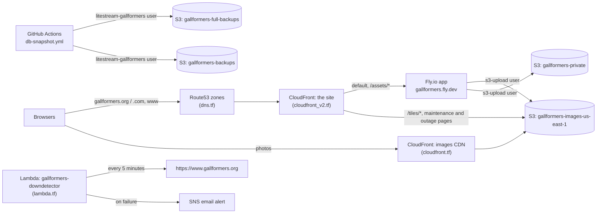

# Gallformers Infrastructure (OpenTofu)

Infrastructure as Code for Gallformers AWS resources using OpenTofu. Day-to-day procedures (plan, apply, import, state recovery) are in [runbooks/opentofu-operations.md](../runbooks/opentofu-operations.md).

## Architecture



## Region Strategy

All AWS resources are in **`us-east-1`** (N. Virginia), the region CloudFront requires for its ACM certificate. The Fly.io production app runs in `ewr` (`fly.toml`), and the preview app in `iad` (`fly.preview.toml`).

## Resources

### S3 Buckets (`s3.tf`)

#### gallformers-images-us-east-1
- **Purpose:** Images (original, small, medium, large, xlarge) under `gall/<id>/`; preview's uploads under `preview/`; the map tiles (`tiles/boundaries.pmtiles`); the maintenance page (`maintenance/`) and the outage page (`outage/`)
- **Access:** Public read of every object by bucket policy (`images_public_read`). The images CDN and the site's `/tiles/*` origin use Origin Access Control; the site's maintenance and outage origins read it publicly
- **CORS:** PUT and GET from the production domains, `gallformers.fly.dev` and `localhost:4000`
- **Versioning:** Enabled
- **Upload:** `s3-upload` IAM user

#### gallformers-private
- **Purpose:** Material that is never served publicly, such as Sources' stored documents and import packages (`Gallformers.Storage.Private`). The `source-ingestions/` prefix holds artifacts of the retired source-ingestion system that nothing reads.
- **Access:** All public access blocked
- **Lifecycle:** Incomplete multipart uploads aborted after 7 days
- **Versioning:** Not enabled
- **Used by:** the app, through the `s3-upload` IAM user

#### gallformers-backups
- **Purpose:** Public downloads
  - `public/gallformers.dump` - the daily public database snapshot (built by `.github/workflows/db-snapshot.yml`)
  - `public/wcvp.dump` - the WCVP database dump (`mix gallformers.wcvp.build_db --upload`; read by `mix gallformers.wcvp.restore`)
- **Access:** Public read for the `public/*` prefix, private otherwise
- **Versioning:** Enabled
- **Public URL:** https://gallformers-backups.s3.amazonaws.com/public/gallformers.dump

#### gallformers-full-backups
- **Purpose:** Full daily pg_dump backups (all tables, includes PII), one per day at `<YYYY-MM-DD>/gallformers.dump`
- **Access:** All public access blocked
- **Versioning:** Enabled
- **Used by:** GitHub Actions (daily snapshot workflow) and `make download-db`

### CloudFront

- **Images CDN** (`cloudfront.tf`) - Serves images from the images bucket via Origin Access Control (OAC).
- **The site's distribution** (`cloudfront_v2.tf`, resource `aws_cloudfront_distribution.v2`) - Answers for `gallformers.org`, `www.gallformers.org`, `gallformers.com` and `www.gallformers.com`, with an ACM certificate for all four (DNS-validated through Route53).
  - Default behavior: proxies every method to the Fly app at `gallformers.fly.dev`, with no caching; an origin request policy forwards the WebSocket headers, and a CORS policy covers LiveView's long-poll fallback.
  - `/assets/*`: from Fly, cached (CachingOptimized).
  - `/tiles/*`: from the images bucket (`s3-tiles` origin, OAC), cached, with a CORS policy for Range requests from any origin.
  - Outage page: CloudFront serves `/outage.html` from the images bucket's `outage/` prefix when Fly returns 500, 502, 503 or 504.
  - Maintenance mode: with `maintenance_mode_enabled = true` (`variables.tf`), the default and `/assets/*` behaviors are served from the images bucket's `maintenance/` prefix. See [runbooks/planned-maintenance.md](../runbooks/planned-maintenance.md).

### DNS (`dns.tf`)

- Route53 hosted zones for `gallformers.org` and `gallformers.com`.
- Apex A and AAAA aliases, and `www` CNAMEs, for both domains, pointing at the site's distribution.
- The ACM certificate's validation records.
- The zones' nameservers are the `nameservers_org` and `nameservers_com` outputs.

### Downdetector (`lambda.tf`, `lambda/downdetector.mjs`)

- Lambda `gallformers-downdetector` requests `https://www.gallformers.org` every 5 minutes (EventBridge schedule).
- On failure it publishes to the SNS topic `gallformers-downdetector`, which emails `alert_email` (set in the gitignored `terraform.tfvars`). A CloudWatch alarm on the Lambda's own errors alerts the same topic.

### IAM (`iam.tf`)

- **`s3-upload`** - The app's S3 user (policy `GallformersImageUpload`): `GetObject`, `Put*` and `DeleteObject` on objects, and `ListBucket`, in the images and private buckets. Its keys are the Fly secrets `S3_PUT_AWS_ACCESS_KEY_ID` and `S3_PUT_AWS_SECRET_ACCESS_KEY`.
- **`litestream-gallformers`** - The database snapshot workflow's user (policy `LitestreamGallformersBackup`): get, put, delete and list in `gallformers-backups` and `gallformers-full-backups`. Its keys are the GitHub Actions secrets `LITESTREAM_ACCESS_KEY_ID` and `LITESTREAM_SECRET_ACCESS_KEY`. The names are historical from the SQLite/Litestream era.
- The downdetector Lambda's role, allowed to write its logs and publish to its SNS topic.

### State

State is in the S3 bucket `gallformers-terraform-state` (key `infra/terraform.tfstate`, encrypted, with S3-native locking; `main.tf`). That bucket is not managed here.

### Outside OpenTofu

The Fly apps, volumes, Postgres and secrets; GitHub Actions secrets; IAM access keys; the personal `jeff` IAM user; Auth0; the domain registrar; the state bucket.

## Deployment

```bash
cd infra
tofu init

# Plan changes
tofu plan

# Apply changes
tofu apply
```

`alert_email` has no default, so `terraform.tfvars` must set it (it is gitignored). Importing existing resources, drift checks and state recovery are in [runbooks/opentofu-operations.md](../runbooks/opentofu-operations.md).

## Next Steps

Tracked infrastructure work is in [docs/backlog.md](../docs/backlog.md).

Key runbooks:
- [opentofu-operations.md](../runbooks/opentofu-operations.md) - Working with OpenTofu
- [planned-maintenance.md](../runbooks/planned-maintenance.md) - Maintenance mode
- [map-tiles.md](../runbooks/map-tiles.md) - The map tiles in the images bucket
- [postgres-maintenance.md](../runbooks/postgres-maintenance.md#backups) - Database backups
